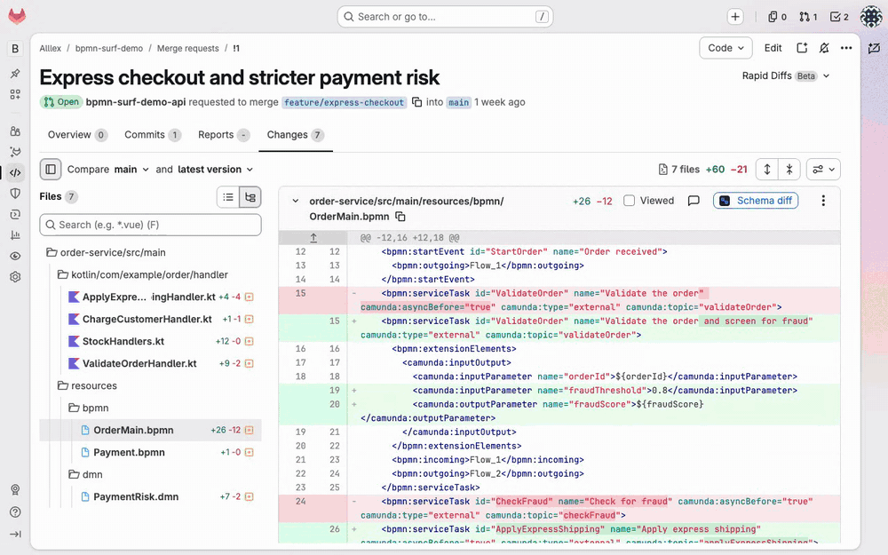
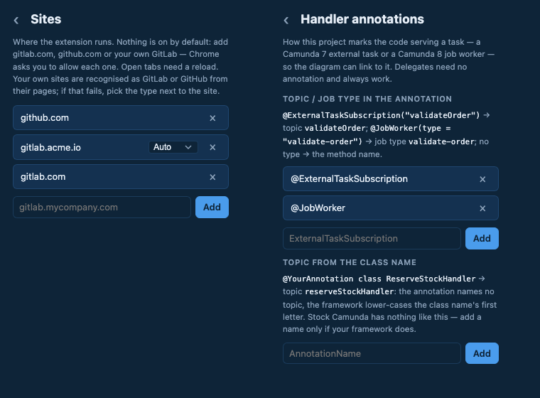
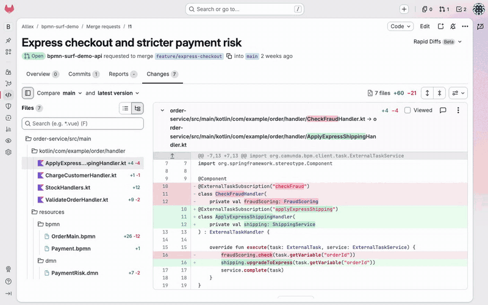
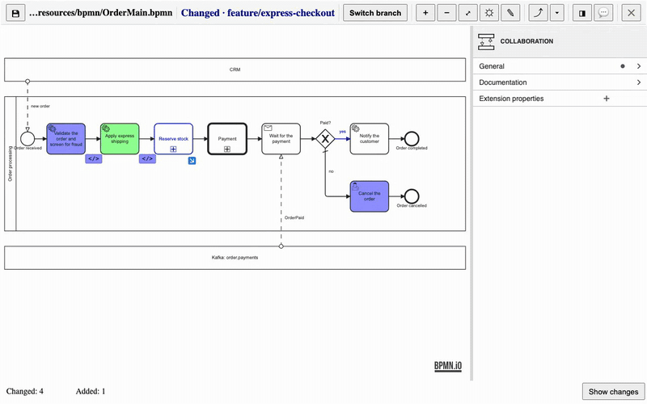
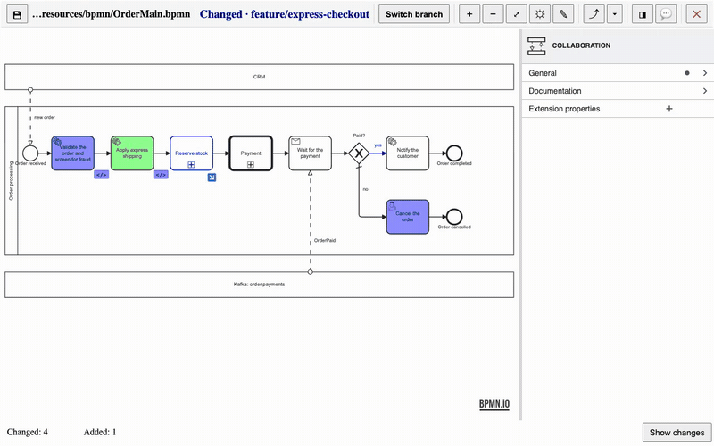
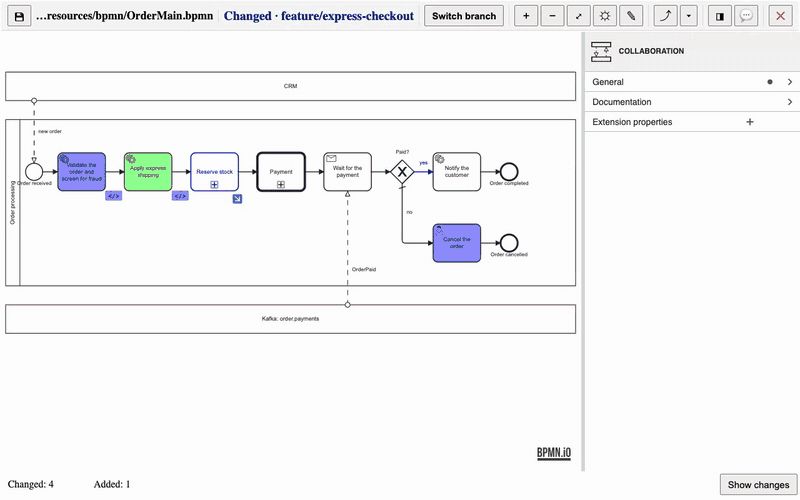
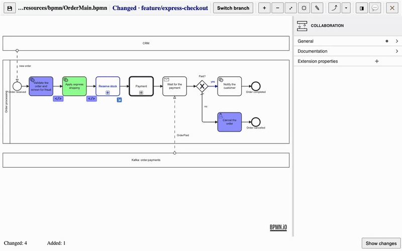
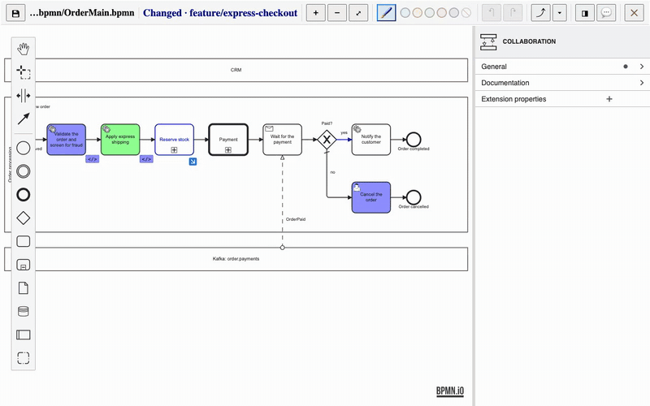
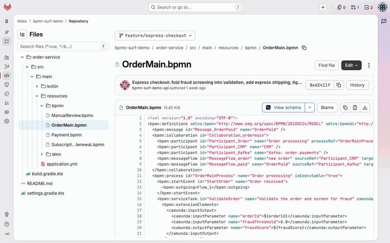

# bpmn-surf

Browser extension that shows BPMN and DMN files in GitLab and GitHub as diagrams. See what a merge or pull request changed, open any diagram straight from the repository, follow called processes and decisions across files, and jump from a task to its code.

Try it on the public demo once the extension is [installed](#installation): a
[merge request on GitLab](https://gitlab.com/kao.alllex/bpmn-surf-demo/-/merge_requests/1)
or a [pull request on GitHub](https://github.com/kaoalllex/bpmn-surf-demo/pull/1).

- Signed out, you get the diffs, diving into called processes and the diff of a changed handler.
- Signed in, you also get the jumps that use the platform's code search: to an unchanged
  handler, to the code that correlates a message, to a called decision, and the list of a
  diagram's callers. gitlab.com and github.com allow code search only to signed-in users.
- On GitHub, signed out, diving in finds only the diagrams the pull request itself changes.

## Requirements

Google Chrome or another Chromium browser that supports Manifest V3 extensions, or Firefox 140+ (desktop).

## Installation

Install **bpmn-surf** from the [Chrome Web Store](https://chromewebstore.google.com/detail/bpmn-surf/baaoelmjlbfjhhkgbfkilgnefegbaldp) or from [Firefox Add-ons](https://addons.mozilla.org/en-US/firefox/addon/bpmn-surf/) — the browser keeps it up to date.
In Microsoft Edge, install it from the Chrome Web Store: Edge offers to allow extensions from other stores.

### From source

The extension has no build step — it runs directly from the source files.

1. Get the sources: `git clone https://github.com/kaoalllex/bpmn-surf.git`, or **Code → Download ZIP** on GitHub and unzip
2. Open the extensions page: `chrome://extensions`
3. Enable **Developer mode** (toggle in the top-right corner)
4. Click **Load unpacked** and select the `bpmn-surf` folder

To update, pull (or re-download) the sources and click ⟳ on the extension in `chrome://extensions`.

### Turning on your sites

Nothing is on by default: the extension runs only on the sites you add, so it asks
for no access to pages you never review diagrams on. Add `gitlab.com`, `github.com` or
your own GitLab from the extension popup — no file editing:

1. Click the bpmn-surf icon in the browser toolbar (it shows `!` while no site is on)
2. Under **Sites**, type the host (`github.com`, `gitlab.com`, `gitlab.mycompany.com`; a
   pasted merge or pull request link works too) and click **Add**
3. Confirm the access request the browser shows
4. Reload the tabs you already had open

Updated from 1.3 and the buttons are gone from `gitlab.com`? The popup offers
**Turn on gitlab.com**.

Only `https` hosts are accepted. A site stays on across updates and re-installs; remove it
with the `×` next to it in the popup. Chrome may still list a removed host under
`chrome://extensions` → Details → Site access, but the extension no longer runs there.

For a team, `npm run package -- gitlab.internal.example` builds a package with the hosts
already on, so nobody needs the popup step.

If your task handlers use an annotation other than `@ExternalTaskSubscription` (Camunda 7)
or `@JobWorker` (Camunda 8), for example `@ZeebeWorker`, set it in the same popup. Export
the settings to a file to hand them to a colleague, who imports them in their popup.

## Features

Buttons appear only on diagrams: on `.bpmn` and `.dmn` files in a merge request, and on a
diagram file in the repository. Camunda 7 and Camunda 8 (Zeebe) diagrams are both
supported: the properties panel, the change highlighting and the readable conditions
(JUEL, FEEL) follow the engine the diagram targets.

On GitHub the buttons sit on the **Files changed** tab of a pull request (public or
private, signed in or out) and on a file page, and they follow the pull request's commit
and range pickers. Navigation needs no token: it uses GitHub's code search on the default
branch plus the pull request's own files (signed out, only the pull request's files).

GitHub Enterprise Server is added like a self-managed GitLab. Its type is recognised from
its pages, or you pick GitLab or GitHub next to the site in the popup.

**Comparing changes**

- The **Schema diff** / **Decision diff** button on a merge request opens a visual diff of the merge request's version against the target branch
- Colours: 🟩 added, 🟥 removed, 🟦 changed. The ☼ toggle also outlines every changed element, so a small one is not missed
- Changes to the process itself, pools, lanes, message flows and artifacts are shown too
- A list of changes: each changed element and connection, with what changed in it. Click a row to jump to the element. The list follows the level on screen: a collapsed subprocess with changes inside is one row, and inside it the list shows its own changes
- A collapsed subprocess is outlined when something inside it changed
- The properties panel highlights what changed: the affected groups, single In/Out mappings and Inputs/Outputs, the changed lines of a sequence-flow condition. A changed element type is marked in the panel header
- In a DMN decision table, the changed cells and rules are highlighted
- **Switch branch** flips between the two versions (the target branch is shown by name); either one can be downloaded
- A clear message when the diagram does not exist in one of the versions
- Diff of a single commit picked in the merge or pull request; on GitHub, also of a range of commits
- Diff of a repository file against a local file (**Diff with local file…** in the menu of the **View schema** button)

**Browsing & navigation**

- The **View schema** / **View decision** button next to a repository file opens it as a diagram, without a diff
- The file path in the header opens the file in the repository
- Dive from a call activity into the called process, and step back
- A menu lists every diagram that calls the one on screen
- Go from a business rule task to its DMN decision, and back
- A badge on a service task opens its handler code (external task, delegate or Camunda 8 job worker): the file in the repository, or its diff when the merge or pull request changed it
- Execution and task listeners get a badge each, captioned by the listener's event (a Camunda 7 class or delegate, a Camunda 8 job worker)
- A badge on a message-catching event or task opens the code that correlates the message

**Reading a diagram**

- A properties panel with the element's details and readable sequence-flow conditions. It opens the groups relevant to the selected element and can be resized or hidden
- Ctrl/Cmd+F finds elements by name, id or any parameter value
- Zoom, pan and **Fit view**

**Editing a BPMN schema**

- The **✎** button opens the diagram on screen in an edit mode, in a separate tab. Nothing is ever written back to the repository
- Edit on the canvas (palette, context pad, undo/redo) and in the properties panel (names, implementation, topics, conditions, In/Out mappings, Inputs/Outputs)
- Edits are coloured against the version you started from (🟩 added, 🟦 changed); the colouring can be turned off, and any element can be coloured by hand
- Download the result as a `.bpmn` file

To review your edits before committing them, open the diagram's file in the repository,
pick **Diff with local file…** in the menu of the **View schema** button and choose the
downloaded file: the edits show up as an ordinary diff against the branch.

## Links

- [Issues](https://github.com/kaoalllex/bpmn-surf/issues) — bug reports and feature requests
- [Privacy policy](PRIVACY.md) — what the extension reads, stores and sends

## Licence

MIT — see [LICENSE](LICENSE).
